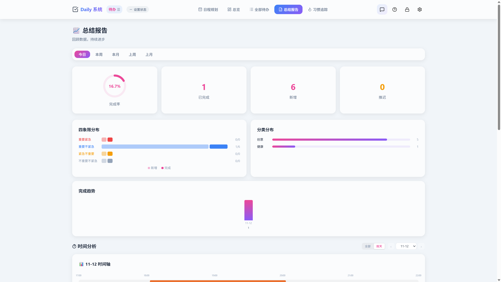
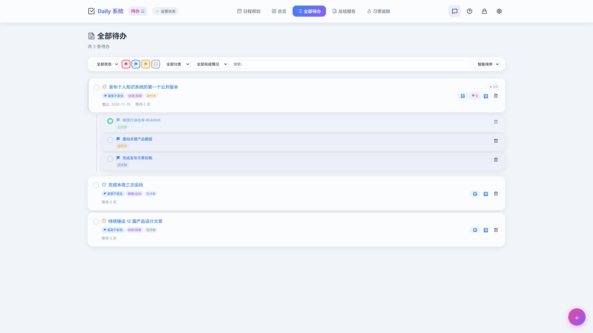
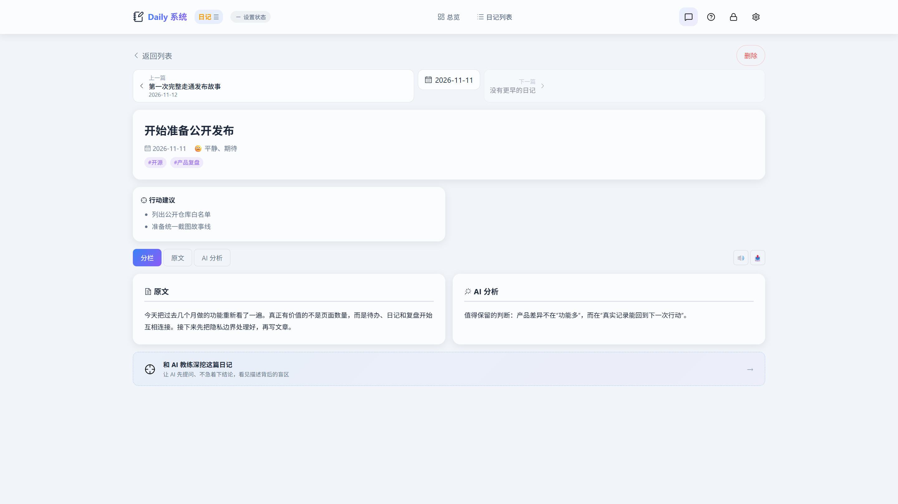
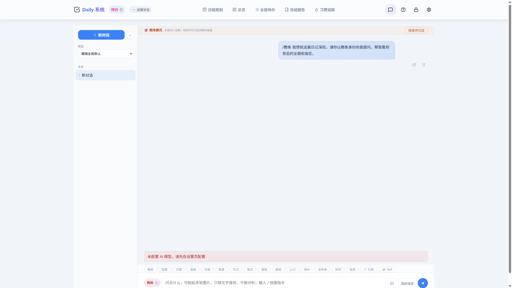
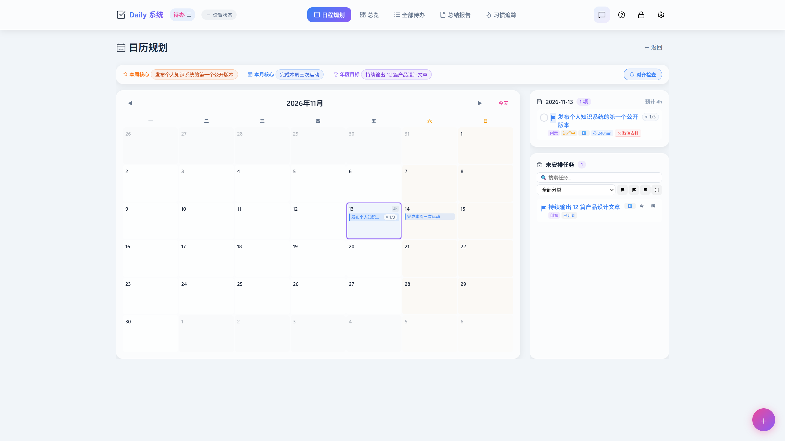
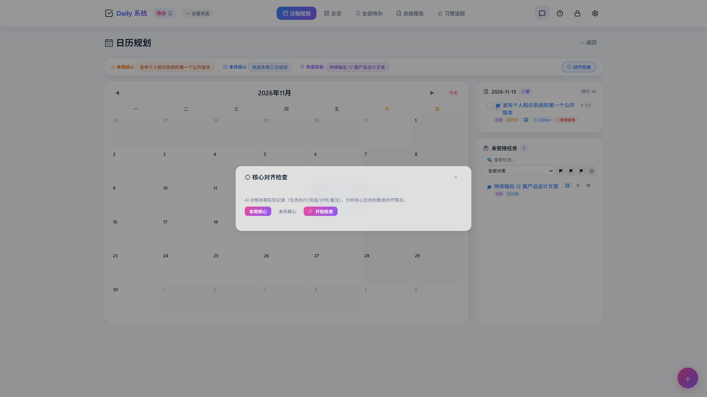
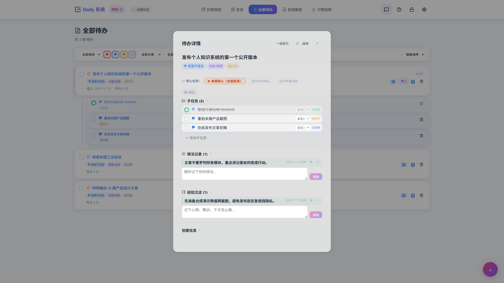

过去一段时间，我一直在给自己做一个叫 Daily 的系统。

最开始它只是几个互不相干的小工具：待办、日记、读书笔记、投资复盘。每个模块都能存东西，但用久之后我发现，真正的问题从来不是“没有地方记录”，而是记录之后没有发生下一步。

日记写完就沉下去了；计划列得很完整，复盘时却说不清真正投入了多少时间；和 AI 聊出一个好想法，过几天又找不到；同一种错误在不同任务里重复发生。

于是我开始问：能不能让 AI 不只陪我聊天，而是先读懂我真实做过什么，再帮我行动？

这就是 Daily 现在的方向：一个自托管的 AI 个人行动与反思系统。

## AI 回答之前，必须先读数据

我曾经问助手：“总结一下我上个月做了什么。”

它给出了一段很流畅的回答，但内容几乎都是空话。问题不在模型不够聪明，而在系统只是把问题交给模型，然后期待它自己想起来调用工具。它可能只查待办，漏掉已经完成的任务；也可能完全不查数据，直接根据对话上下文发挥。

这让我确定了第一个原则：

> 对事实型问题，先取数，再表达。

现在，当问题里同时出现“总结、回顾、做了什么”和“本周、上个月、某个日期范围”时，服务端会先解析周期，再把同一范围内的待办、完成备注、计时、日记、笔记和心力记录打成数据包。模型负责归纳，但不能跳过取数。

计划日期也不等于真实发生。一个任务可能计划在周一，真正完成在周三；也可能一直挂在日历上却没有投入。Daily 会同时看计划、完成时间、计时和补充记录。没有数据时，它应该直接说不知道，而不是为了完整编一个故事。

这是我对“可信 AI”最朴素的理解：不是每次都能回答，而是知道自己的答案来自哪里。

## AI 可以拆任务，但不能替我做决定

我经常把一堆零散事项直接丢进输入框。让模型生成待办并不难，难的是它一旦直接写库，错误就会变得很隐蔽：两件独立的事被合并、子任务层级不对、紧急度判断偏了，或者改写后丢掉原意。

所以 `/任务单` 不直接创建任务，而是先给一份可编辑草稿。我可以改标题、增删任务、调整象限和紧急度，也可以把子任务提升成独立任务。只有点下确认，数据才真正写入。

这个确认门后来成为整个系统的通用规则：查询可以直接做，创建、完成、排期、保存记录等写操作必须让用户看到即将发生什么。

AI 很适合提供结构和建议，但个人系统的最终控制权应该留给本人。

## 反思必须回到行动

日记分析是另一个让我反复修改的功能。

早期版本会固定输出“整体印象、值得肯定、需要注意、第三视角、行动建议”五段。看起来很专业，用久了却像模板作文。哪怕我只写了一句流水账，它也会努力凑出几条洞察。

现在的规则是：先判断有没有真正值得说的内容。没有就简短确认；有的话只说最重要的点，不凑数量。

如果一篇日记里有值得继续探索的问题，我可以从原文进入教练模式。教练不会马上给建议，而是一次只问一件事。对话结束后，它会沉淀一个可以验证的行动承诺；我确认后把它变成待办。任务完成时，跟进项也会关闭；下一次教练会话先回看上次承诺。

我想要的不是一次“聊得很有收获”的体验，而是反思、承诺、执行和复查真正形成闭环。

## 目标不是挂在首页，而是检查时间投向

Daily 允许把现有任务设为本周、本月或年度核心目标。它没有再造一套 OKR，而是在已有行动上增加周期焦点。

更重要的是“对齐检查”：系统会把本期实际完成、计时和记录与核心目标放在一起，回答的不是“这周忙不忙”，而是“时间有没有投向真正重要的事”。

任务执行过程中产生的想法和教训，也不再散落到另一份笔记里，而是直接附着在真实任务上，下一次做相似事情前可以重新找回来。

## 为什么现在开源

Daily 已经成为我每天真的会用的系统，但它仍然有很多个人项目的痕迹：单用户、SQLite、功能很多、界面还在持续调整。

我选择现在开源，不是因为它已经“做完”，而是因为其中有几套设计也许对其他人有参考价值：

1. 事实型 AI 问答应该由程序先确定性取数；
2. AI 写操作应该默认经过确认；
3. 个人数据应该优先自托管；
4. 分析不应为了显得聪明而强行输出；
5. 记录、行动、复盘和经验应该可以互相连接。

公开版本使用完全虚构的演示数据，不包含我的真实日记、画像或模型密钥。仓库采用 AGPL-3.0：你可以学习、修改和自行部署；如果修改后通过网络提供服务，也需要向用户开放对应源代码。

项目地址：[github.com/08163356/daiy-workshop](https://github.com/08163356/daiy-workshop)

如果你也在做自己的个人系统，我很想知道：你最希望 AI 在“记录之后”帮你完成哪一步？
