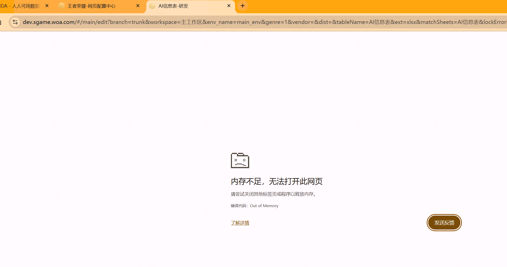
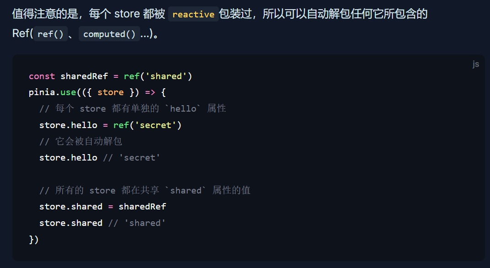
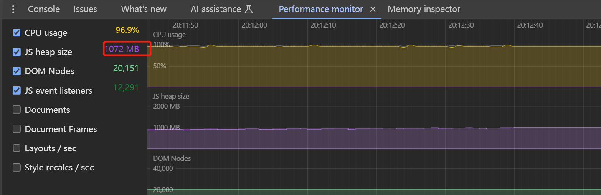
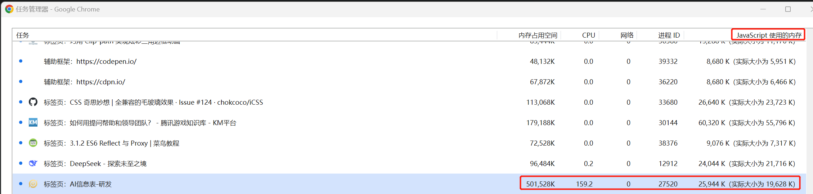
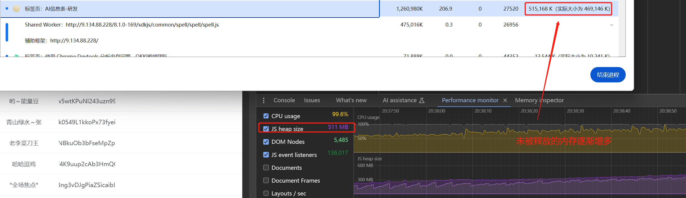
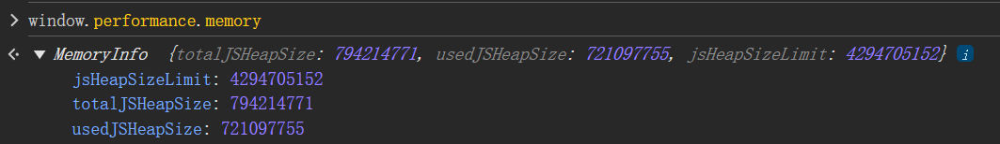
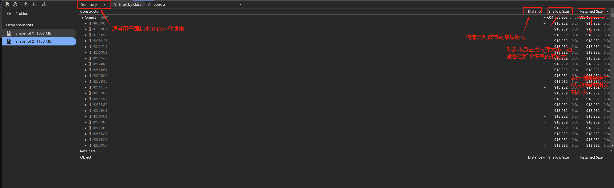
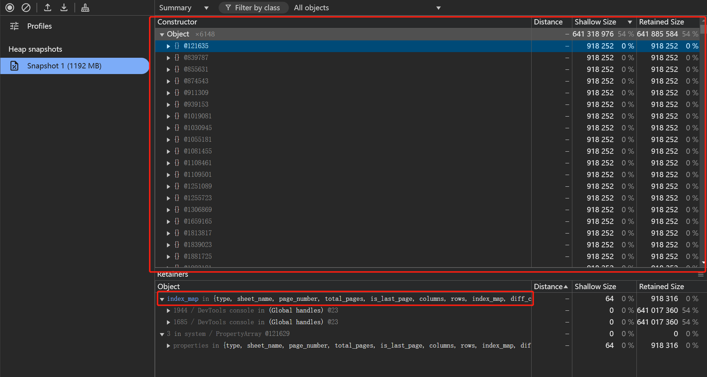
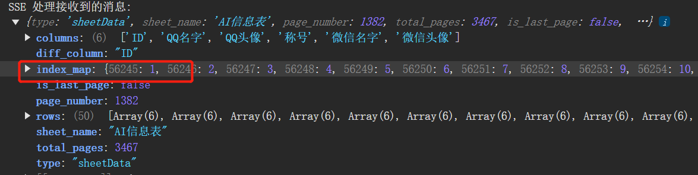
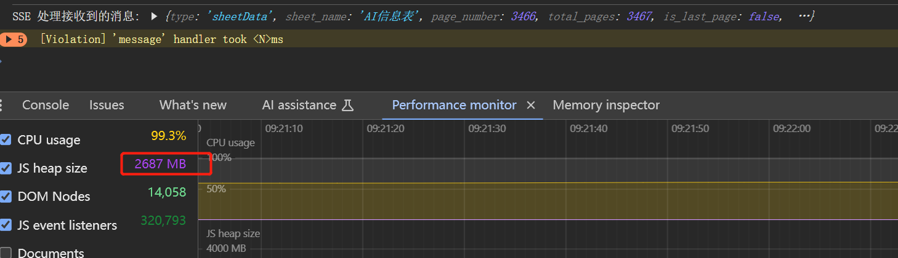

---
title: 记一次内存一直增长解决方案
date: 2025-04-30 17:17:37
permalink: /pages/4cdf9c/
categories:
  - 性能优化
  - 内存泄漏
tags: []
author: 
  name: aXing
  link: https://github.com/08163356
---
内存泄漏：指由于疏忽或错误造成程序未能释放已经不再使用的内存。内存泄漏并非指内存在物理上的消失，而是应用程序分配某段内存后，由于设计错误，导致在释放该段内存之前就失去了对该段内存的控制，从而造成了内存的浪费。

## 现象

连续滚动一段时间后出现了这种情况：

## 分析

因为后台表格返回了批量的数据，前端使用pinia去存储这些数据，一共两份，一个是纯后台数据，一个是经过处理后前端使用的数据，而pinia中的数据使用reactive存储从而形成响应式，添加过多的响应式会导致内存一直的增长

引起内存泄露的原因可能有闭包、全局变量、未及时清除的定时器或者回调、dom节点的增长、循环引用等。从performance monitor里面也能看到一直增长的是Js heap size，dom node和event listeners基本处在平稳的状态。

开启JS内存后看到没打开新开发的功能之前是这样：

- JavaScript 使用的内存 表示 JS 堆内存，有括号外和括号内两个值。我们关注括号内的实际值，这个值代表了当前页面可访问（reachable）的对象占用了多少内存，直白一点就是实际被使用，不会被 GC 的对象占用的内存大小。

开启新开发功能的一段时间后：

自身浏览器最大堆内存也是如下，经过试验后的确实在这附近就开始崩溃，由此可以有初步的结论就是js heap内存增加导致的out of memory。

接下来是定位什么地方没有被释放，虽然心里已经有数大概率是pinia中的内容，但是想实践一下。通过生成两个快照并进行对比：

顺便回顾下snapshot的使用

`@` 字符后面的数字是对象的唯一 ID

由此看到的所占用内存最多的确实是后端传递过来，然后存储在前端的响应式数据，而index_map占用得尤为多，但是index_map实际上一个表只需要一份就可以了，因此可以在代码中将index_map提取出来单独存储，然后删除掉原数据中的index_map

经过实践发现index_map数据即使在控制台的console中展开都会导致卡死，所以先考虑将其删掉

## 结论

实践后确实有效果，就是index_map数据量太大导致的，但是目前js的heap size还是在增加，虽然没有之前的频繁了，那需要进行堆快照的对比，看看是那部分一直存在导致的

最终结果是全部页面加载完毕也没有出现out of memory：

参考文档（有用）：https://developer.chrome.com/docs/devtools/memory-problems/heap-snapshots?hl=zh-cn