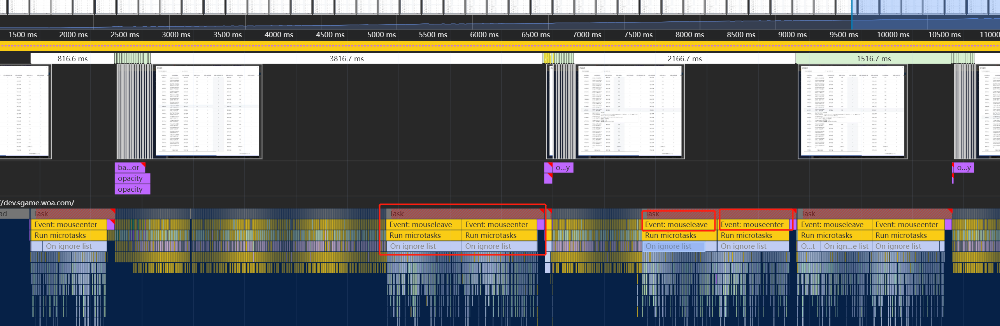

---
title: 记一次前端滚动性能优化
date: 2025-04-30 17:17:38
permalink: /pages/6ac9b2/
categories:
  - 性能优化
  - 项目性能分析、优化
tags: []
author: 
  name: aXing
  link: https://github.com/08163356
---
最近遇到了大表格滚动时候会有卡顿的问题，想办法优化下

## 方案一：给监听器添加passive

浏览器有一个提示是

```
[Violation] Handling of 'wheel' input event was delayed for 2710 ms due to main thread being busy. Consider marking event handler as 'passive' to make the page more responsive.
```

也就是滚动性能耗费了2-3s，这地方可以着重优化

出现该提示是因为滚动事件处理函数执行时间过长，阻塞了主线程，导致滚动卡顿。

事件监听器（如wheel、touchstart等）可能会阻塞页面的滚动，因为浏览器需要等待事件处理函数执行完毕才能进行后续的渲染操作。特别是当这些事件处理函数中有大量耗时操作时，会出现明显的卡顿。 警告中提到的“passive”选项是关键。被动事件监听器（passive event listeners）告诉浏览器，事件处理函数不会调用preventDefault()，这样浏览器可以在处理事件的同时继续渲染页面，从而提升滚动性能。

那在vue中如何添加passive呢？

```
@wheel.passive="handleWheel"
```

滚动过程中对于事件的处理耗费了大量的时间（700多ms）。



期望在滚动的时候先不要处理悬浮提示等事件

对要滚动的区域使用硬件加速

```
          :deep(.el-table-v2__body) {
            will-change: transform;
            backface-visibility: hidden;
            transform: translateZ(0);
```

