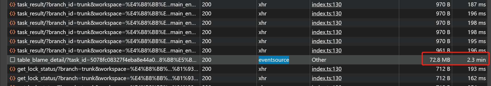

---
title: SSE导致前端卡顿的问题
date: 2025-04-30 17:17:38
permalink: /pages/f1b5bf/
categories:
  - 性能优化
  - 项目性能分析、优化
tags: []
author: 
  name: aXing
  link: https://github.com/08163356
---

这段时间内后端批量数据的发送导致前端卡顿

## 排查：

1.只计算第一张表第一页的时候。卡

2.只计算第一张表第一页；并且将首屏显示的行数缩短到只有一行，卡

初步结论：blame

## 建议：

1.将数据进行分块发送（但是当前已经分了很多块了）

2.数据进行压缩；

3.别一次性发送所有的数据

## 前端方案